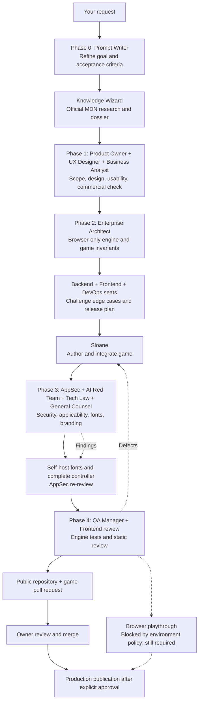

# War Room — Project: Stillblocks

The diagram records the actual work performed. Role seats ran as separate agent turns; some agents were reused between phases. Sloane authored and integrated the website because the Sites owner handles its source and hosting lifecycle.

## Decisions

- Native static HTML, CSS and JavaScript: no game framework, backend or login.
- Separate deterministic engine, canvas renderer and semantic controls.
- Warm original styling, visible keyboard guide, ghost and upcoming pieces.
- Pause on tab hiding/focus loss; freeze timers and clear held inputs.
- Confirm restart, preserve modified browser shortcuts and Tab behavior.
- Self-host fonts with licenses; no application tracking or storage.
- QA verifies game invariants; browser QA remains explicitly unverified.
- Owner controls merging and production approval.

## Review outcomes

Product, UX, Business and architecture seats approved the defined scope. AI red-team review found no AI surface. AppSec passed the final static review. Tech Law requested self-hosted fonts; implemented with OFL notices. General Counsel identified no scope blocker and required publication-file and license checks. QA evidence is in the tests and pull request.
